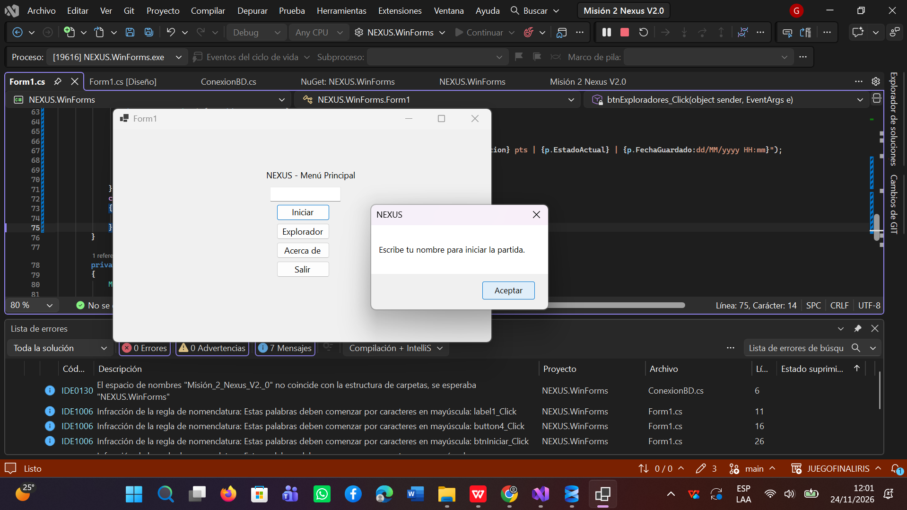
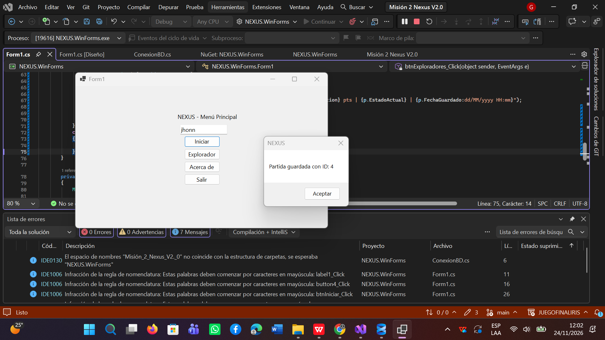
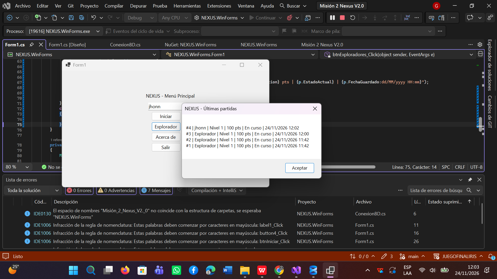
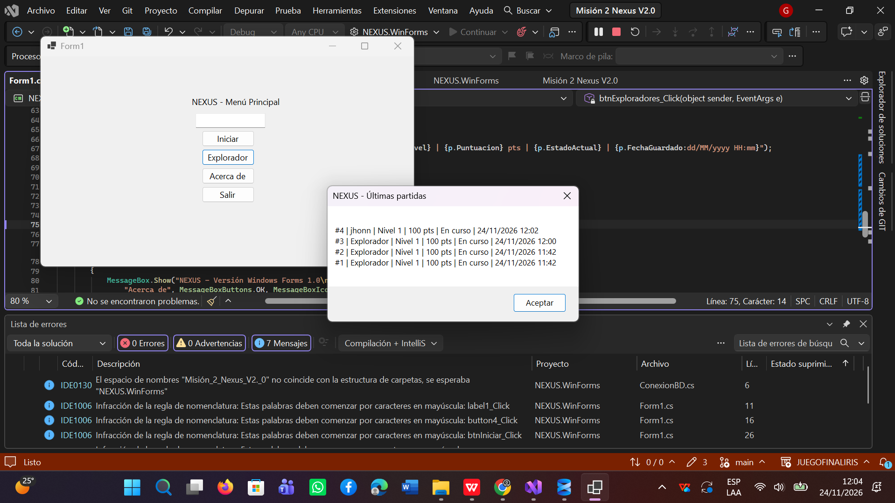

# NEXUS - Sistema de Gestión y Expediciones Multidimensionales

## 📋 Descripción del Proyecto
**NEXUS** es una aplicación de escritorio desarrollada en **C# con Windows Forms y SQL Server**, concebida como un videojuego de estrategia, gestión y exploración de realidades. El proyecto evoluciona desde una arquitectura basada en consola (Hito 3) hacia una interfaz gráfica orientada a objetos, con persistencia de datos en SQL Server.

---

## 🚀 Funcionalidades Implementadas
* **Gestión de Exploradores:** creación de exploradores con validación de datos (por ejemplo, el nombre no puede estar vacío).
* **Guardado de partidas:** las partidas se almacenan en SQL Server.
* **Recuperación de partidas:** al cerrar y volver a abrir NEXUS, las partidas siguen disponibles en el Explorador.
* **Manejo de errores de conexión:** si no hay conexión con SQL Server, el juego muestra un mensaje claro en lugar de cerrarse.

---

## 🛠️ Tecnologías y Arquitectura
* **Lenguaje:** C# (.NET / Windows Forms)
* **Base de datos:** Microsoft SQL Server (ADO.NET)
* **Arquitectura:** por capas (Presentación - UI, Lógica de Negocio, Acceso a Datos)

---

## 📦 Requisitos
* Windows 10 u 11
* Visual Studio 2022 con la carga de trabajo **Desarrollo de escritorio con .NET**
* SQL Server Express (o cualquier instancia de SQL Server) y SQL Server Management Studio (SSMS)

---

## ⚙️ Cómo Ejecutar el Proyecto
1. Clona el repositorio desde Visual Studio (**Clonar un repositorio**) en una carpeta nueva.
2. Abre SSMS, conéctate a tu instancia de SQL Server y ejecuta **en este orden** los scripts de la carpeta `sql/`:
   1. `01_crear_base.sql` (crea la base de datos NexusDB)
   2. `02_crear_tablas.sql` (crea las tablas y datos iniciales)
3. Abre la solución en Visual Studio.
4. Ajusta la cadena de conexión en `App.config` con el nombre de **tu** servidor. Ejemplo:
   ```xml
   Server=.\SQLEXPRESS;Database=NexusDB;Trusted_Connection=True;
   ```
   Cambia `.\SQLEXPRESS` por el nombre de tu instancia (se ve en SSMS al conectarte).
5. Compila y ejecuta con `F5`.

---

## 🎮 Cómo Jugar
1. Escribe el nombre de tu explorador y crea la partida.
2. Guarda la partida.
3. Cierra NEXUS con **Salir** y vuelve a abrirlo.
4. Entra a **Explorador** para ver tus partidas guardadas.

---

## 🧪 Evidencias de Pruebas
| Prueba | Captura |
|---|---|
| Validación de nombre vacío |  |
| Guardar partida |  |
| Recuperar partidas |  |
| Persistencia tras cerrar y abrir |  |

---

## 📁 Documentación del Proyecto
Toda la documentación técnica, de diseño y arquitectura está en la carpeta [docs/](docs/):
* [Diseño del Juego](docs/diseno-del-juego.md)
* [Arquitectura Actual (H3)](docs/arquitectura-actual.md)
* [Arquitectura Propuesta](docs/arquitectura-propuesta.md)
* [Modelo de Datos Propuesto](docs/modelo-de-datos-propuesto.md)
* [Análisis Técnico](docs/analisis-tecnico.md)
